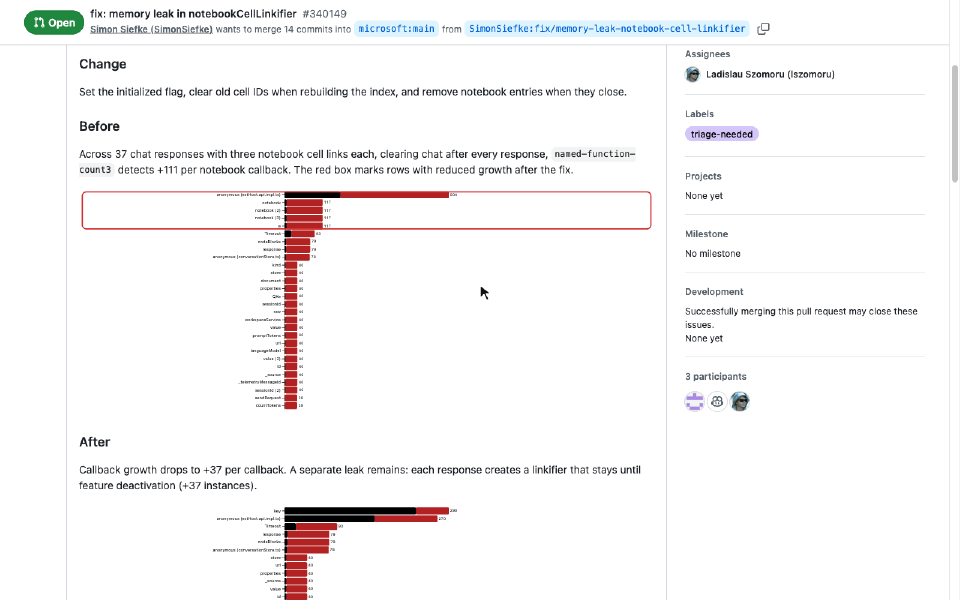
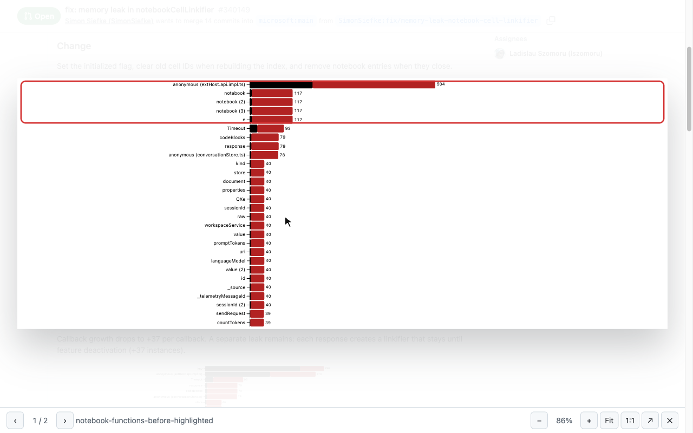
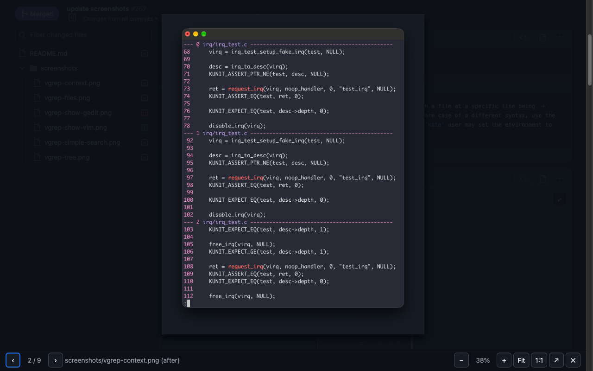
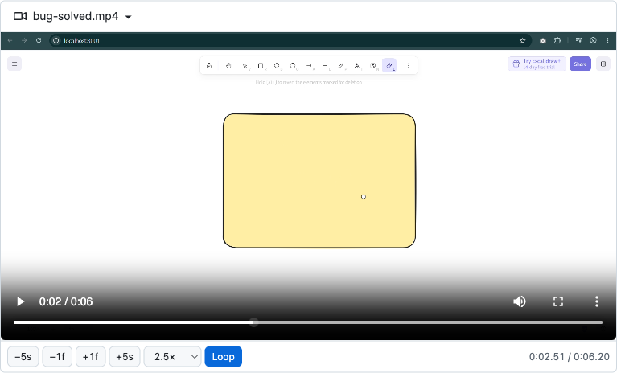

# Media Viewer for GitHub PRs

Chrome extension (Manifest V3) that opens images in GitHub pull requests in an in-page lightbox instead of a new tab, and gives PR videos the controls GitHub's player is missing.

## Demo



*Clicking a comment screenshot, zooming, panning, stepping to the next image and closing it, then opening an image diff from **Files changed** and flipping between before and after.*

**Screenshot in a PR comment.** Clicking it opens the viewer on the page, with zoom, pan, ←/→ between images, and a toolbar that follows GitHub's light theme:



**Image diff in Files changed.** The ⤢ button on the diff opens the *before* and *after* images full size. Here it's showing *after* (2 / 9) in GitHub's dark theme:



**Video in a PR comment.** A toolbar under the video adds ±5s skip, frame stepping, speeds up to 4× and loop, plus a clock in hundredths of a second:



### Try it yourself

With the extension installed, open these public PRs:

- [microsoft/vscode#340149](https://github.com/microsoft/vscode/pull/340149): click either chart screenshot in the description.
- [excalidraw/excalidraw#12353](https://github.com/excalidraw/excalidraw/pull/12353): two screen recordings. Click the video, then try `→`, `.`, `>` and `k`.
- [vrothberg/vgrep#267 → Files changed](https://github.com/vrothberg/vgrep/pull/267/files): click ⤢ on any `.png` diff, then press → to step through before/after for every changed screenshot.

## Build and install

```sh
npm install
npm test          # vitest + jsdom
npm run build     # → dist/
```

1. Open `chrome://extensions` and turn on **Developer mode**.
2. Click **Load unpacked** and select the `dist/` folder.
3. **Refresh any GitHub tabs that were already open.** Chrome only adds the extension to pages loaded after it was installed or reloaded. Until you refresh, clicks open a new tab as before.
4. After a rebuild, click the reload icon on the extension card, then refresh the tab.

## Publish

`npm run package` type-checks, tests, builds and writes `extension.zip`. Upload it in the [Chrome Web Store Developer Dashboard](https://chrome.google.com/webstore/devconsole). The listing copy, privacy answers and screenshots are in [`store/`](store/LISTING.md). For an update, bump `version` in `manifest.json` first.

## Usage

| Where | How |
|---|---|
| Description / comments / review threads | Click an image. Cmd/Ctrl/Shift/middle-click still open a new tab. |
| Files Changed image diffs | Click the ⤢ button in the top-right of the diff. The gallery shows *before* and *after*. |

| Key / gesture | Action |
|---|---|
| `Esc`, click backdrop, ✕ | Close |
| `←` / `→` | Previous / next image on the page (wraps) |
| `+` / `-`, mouse wheel / pinch | Zoom (wheel zooms at the cursor) |
| `0` / `1` | Fit to screen / original resolution |
| Drag | Pan |
| Double-click | Toggle fit ↔ 100% at the cursor |
| ↗ | Open original in a new tab |

### Videos

Every uploaded video on a PR page gets a toolbar under GitHub's player (videos in issues and elsewhere are left alone). Shortcuts work once you've clicked the video, its native controls or the toolbar, including in fullscreen. They never fire while you're typing elsewhere.

| Key / button | Action |
|---|---|
| `←` / `→`, `j` / `l`, **−5s / +5s** | Back / forward 5 seconds (the native arrows only move 1% of the video) |
| `,` / `.`, **−1f / +1f** | Previous / next frame, pausing first |
| `<` / `>`, speed menu | Slower / faster: 0.25× to 4× (native stops at 2×). A video you've set keeps its speed; one you haven't starts at the last speed you picked |
| **Loop** | Loop the video |
| `k` | Play / pause (`Space` works natively too) |
| `m` | Mute / unmute (GitHub starts videos muted) |
| `f` | Fullscreen |

The clock is exact when paused or stepping. While playing, it updates when the browser reports progress, about 4 times a second.

Kept native: volume, fullscreen and picture-in-picture buttons, download, and the scrubber.

## How it works

What GitHub does today (checked against live pages, Oct 2026):

- **Markdown images** (descriptions, comments) are rendered as `<a target="_blank" href=SRC></a>` inside `.markdown-body`, so clicking opens a new tab. External images use a `camo.githubusercontent.com` `src`, with the original URL in `data-canonical-src`.
- **Badge-style images** (`[](ci-url)`) link elsewhere. They are left alone.
- **Videos** are a bare `<video controls muted>` inside a `<details>` frame, capped at 640px tall. Chrome's player has no skip, no frame step and stops at 2×, and its arrow keys move 1% of the duration (0.06s on a 6s clip).
- **Uploaded media links expire.** `src` is a `private-user-images.githubusercontent.com/…?jwt=` URL that is valid for 300s. Chrome buffers only the start of a video, so playing one in a PR tab open longer than 5 minutes fails with `MEDIA_ERR_NETWORK` ("data source error"). This was reproduced on a live PR.
- **Image diffs** in Files Changed are rendered in a cross-origin `viewscreen.githubusercontent.com` iframe that has its own 2-up/swipe/onion-skin viewer and no zoom. Clicks and even hovers inside it never reach the page. The iframe's `enc_url1`/`enc_url2`/`enc_url` query params hold the raw image URLs, hex-encoded.

The extension does four things:

- **One delegated `click` listener** on `document`, bubble phase. It acts only on a PR URL, on an unmodified left click, on an `` inside `.markdown-body` whose link points at the image itself. Everything else, including clicks GitHub already handled (`defaultPrevented`), passes through untouched. Comments loaded later and Turbo navigation work automatically.
- **Diff iframes** get an expand button. A 1ms CSS animation on `iframe[src^="https://viewscreen…"]` fires `animationstart` once per iframe as it renders, so there is no MutationObserver over GitHub's DOM. The image URLs are decoded from the iframe `src`. Nothing is injected into the iframe, so no extra host permission is needed.
- **Videos** get a toolbar from the same animation detector (`.markdown-body video`). Keys are handled in a capture-phase listener, and only when the target is an enhanced video or its toolbar. On a media error, the video reloads from `github.com/user-attachments/assets/<id>`, which re-signs on every request, and resumes at the same time and speed. Decode errors are skipped, because a fresh URL can't fix a bad file, and there's at most one reload per minute, so a broken or crafted upload can't cause a reload loop. A real expiry needs one reload per 5-minute link lifetime.
- **Viewer**: a native `<dialog>` opened with `showModal()`, which provides the top layer, focus trap, `Esc` and focus restore. The gallery is collected from the page when the viewer opens. Colours come from GitHub's Primer CSS variables, so light, dark and high-contrast themes follow automatically.

**Permissions:** none. There is only a content script on `https://github.com/*`, which is needed because GitHub navigates between pages without a reload and won't re-inject a script that matches only `/pull/` URLs.

## Layout

```
manifest.json
src/images.ts    which images qualify, diff-URL decoding, gallery collection (pure)
src/viewer.ts    dialog, zoom/pan math, keyboard handling
src/video.ts     video toolbar, shortcuts, expired-link recovery
src/content.ts   the click listener, the render detector and the key listener
src/content.css  viewer + video toolbar styles, render detector
test/            fixtures based on real GitHub markup
```

## Contributing

Conventions, verified GitHub/Chrome behaviour and the testing rules are in [CLAUDE.md](CLAUDE.md). To check a change on real GitHub pages (the Playwright browser can't load an unpacked extension), follow [`.claude/skills/verify-on-github`](.claude/skills/verify-on-github/SKILL.md).

## Known limits

- Verified on the classic Files Changed page (logged out). The newer React "changes" page may differ. If the expand buttons don't appear there, check the iframe `src` prefix in `src/images.ts`.
- Frame stepping assumes 30 fps, typical of screen recorders. On a 60 fps recording each step moves two frames.
- Images inside rich diffs of other file types (e.g. rendered Markdown or SVG) are not included. Those use different renderers.
